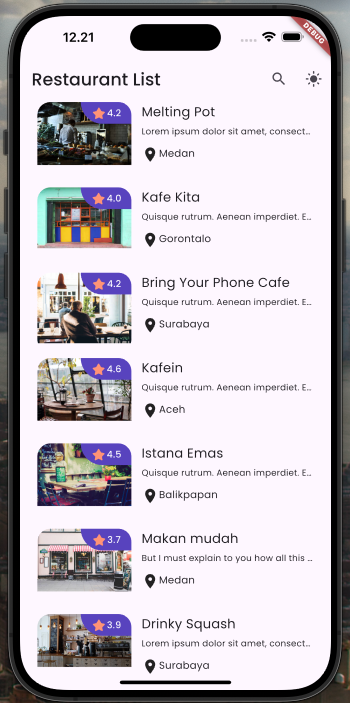
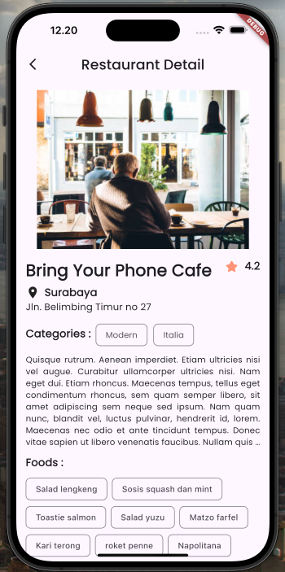

<p align="center">
  
</p>

<h1 align="center">Restaurant App</h1>

<p align="center">
  <b>Katalog restoran dengan pencarian, favorit offline, dan notifikasi harian.</b><br>
  Submission Fundamental Flutter — Dicoding Academy
</p>

<p align="center">
  <a href="https://flutter.dev"></a>
  
  
</p>

---

## ✨ Preview

<p align="center">
  
</p>

<table align="center">
  <tr>
    <td></td>
    <td></td>
  </tr>
  <tr>
    <td align="center">Daftar restoran</td>
    <td align="center">Detail restoran</td>
  </tr>
</table>

---

## 📖 Tentang

Aplikasi katalog restoran yang dibuat untuk submission **Fundamental Flutter** di Dicoding.
Data diambil lewat HTTP, disimpan untuk favorit secara lokal, dan aplikasi mengirim
notifikasi pengingat harian.

---

## 🌟 Fitur

- 🍽️ **Daftar restoran** dari API
- 🔎 **Pencarian** restoran
- 📄 **Detail restoran** dengan info dan ulasan
- ⭐ **Favorit offline** (SQLite)
- 🔔 **Notifikasi harian** dengan local notifications + timezone
- 🌗 **Tema** (light/dark)
- 🧪 **Unit & widget test** dengan Mockito

---

## 🛠️ Tech Stack

| Area | Pilihan |
|---|---|
| Framework | Flutter |
| State management | Provider |
| Database lokal | `sqflite` |
| HTTP | `http` |
| Notifikasi | `flutter_local_notifications`, `timezone` |
| UI | Google Fonts |

---

## 🧱 Struktur

```text
lib/
├── data/         # Model, datasource, repository
├── provider/     # home, detail, search, favorite, notification, reviews, theme
├── screen/       # Halaman
├── services/     # Layanan pendukung
└── style/        # Tema & gaya
```

---

## 🚀 Menjalankan

```bash
flutter pub get
flutter run
```

---

## 🧪 Testing

```bash
flutter analyze
flutter test
```
